Running notes on the data. Each finding has the numbers that back it, and the
code cells re-run the boxes in `boxes/`, so the report can be regenerated.
Run it from the project root with the `AI` conda environment.

## 1. Setup

```{python}
import json
from boxes.Product_description import KNOWLEDGE_PATH, clean_row, load_alerts
from boxes.data_analysis import (
    show_overview, check_duplicates, check_missing_and_types, missing_values,
    text_length_distribution, length_by_group, plot_top_categories_brands_countries,
    plot_risk_types, risk_type_by_category, law_name_types, law_risk_category,
    time_trend, similar_descriptions_share_risk, leakage_check, multi_risk_alerts,
    product_variety, product_vs_risk,
)

alerts = load_alerts(KNOWLEDGE_PATH)
cleaned_rows = clean_row(alerts)
```

## 2. Size and shape

```{python}
show_overview(cleaned_rows)
```

**Findings**

- 12,211 alerts, 7 columns after `clean_row`: index, category, product, name,
  brand, description, country_of_origin.
- `index` runs 1 to 12,211 and is the key to track a row back to its alert.

## 3. First look at the rows

**Findings (from the first 5 rows)**

- Missing values are real: row 2 has no brand, row 3 has no country.
- Some descriptions only repeat the product (rows 4 and 5: "Motorcycle",
  "Light commercial vehicle"). With the `product + description` text this gives
  "Motorcycle. Motorcycle."
- Names are not always English (rows 2 and 3 are French).

## 4. Duplicates

A row is a duplicate when every cleaned field (category, product, name, brand,
description, country_of_origin) is the same as an earlier row. `index` is
ignored. The first copy is kept.

```{python}
#| output: false
unique_rows = check_duplicates(cleaned_rows)
```

```{python}
print(f"cleaned rows: {len(cleaned_rows)}, unique rows: {len(unique_rows)}, "
      f"duplicates: {len(cleaned_rows) - len(unique_rows)}")
```

**Findings**

| Measure | Value |
|---|---|
| Cleaned rows | 12,211 |
| Duplicate rows | **211** (1.7%) |
| Rows left after removing them | 12,000 |
| Texts that appear more than once | 140 (up to 12 copies of one text) |

Checked against the full alert of each duplicate and its first copy:

| Check | Duplicates that match |
|---|---|
| Same `case_number` | 0 of 211 |
| Same notifying country | 191 of 211 |
| Same risk types | 176 of 211 |
| Same report date | 88 of 211 |

- **Yes, there are duplicates in the cleaned rows.** None is the same alert
  twice (no shared case number). They are different alerts about the same
  product description, for example repeated recalls of one car model.
- They are concentrated in short, generic texts: 113 of 211 are Motor vehicles
  (e.g. "Passenger car"), then Cosmetics (30) and Toys (20).
- In 35 of 211 cases the copy has a different risk type than the first one, so
  the same text can carry different answers.
- Why it matters: if one copy lands in the library and another in the test
  split, the search finds an identical text and the score looks better than it
  is (plan section 5: dedupe, and keep twins on one side of the split).
- These are exact copies of the cleaned fields only. Near-twins (almost the same
  text) are not counted here; the plan also asks for a similarity check.
- Sections 5 and 6 and later use all 12,211 rows, except the missing-values
  and types table in Section 5, which uses the 12,000 unique rows.

## 5. Missing values and types

```{python}
check_missing_and_types(unique_rows)
```

```{python}
missing_values(cleaned_rows)
```

**Findings** (on all 12,211 cleaned rows)

- 5,318 of 85,477 cells are missing (6.2%), in 3 of 7 columns.
- Only `name` (1,535, 12.6%), `brand` (2,476, 20.3%) and
  `country_of_origin` (1,307, 10.7%) have gaps.
- `category`, `product`, `description` and `index` have none. Also checked:
  no blank or whitespace-only text, and no "none" / "n/a" / "-" placeholders in
  `product` or `description`.
- Effect on the text we embed: `description` and `product` are always there, so
  those variants never fail. A `name + description` text has no name in about
  1 row in 8, so `build_text` must decide what to do then.

## 6. Text length

```{python}
length_stats = text_length_distribution(cleaned_rows)
```

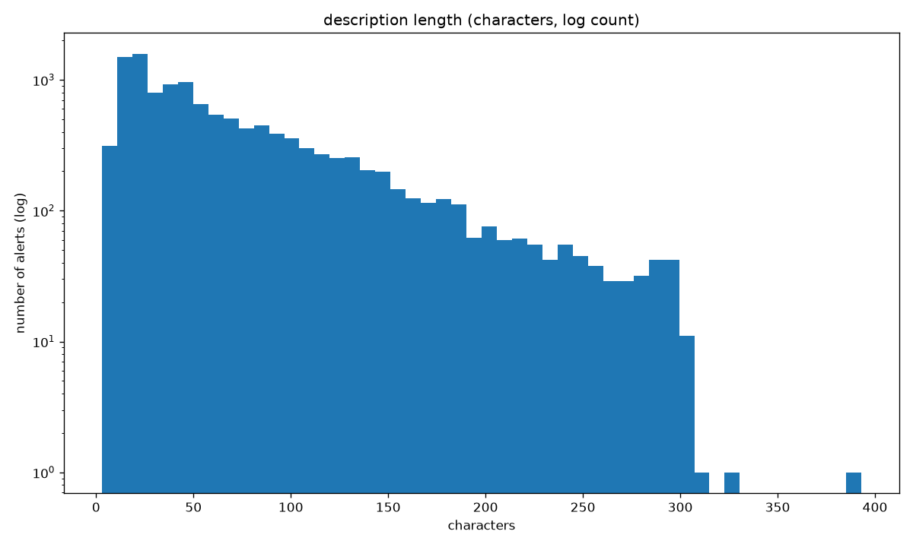

**Findings** (description, in characters, 12,211 rows)

| Measure | Characters |
|---|---|
| min | 3 |
| median | 50 |
| mean | 70.8 |
| 90th percentile | 156 |
| 95th percentile | 198 |
| 99th percentile | 277 |
| max | 393 |

- Most descriptions are short: typical length 50 characters (8 to 10 words).
- Moderate long tail: the mean is above the median, and 1,324 rows (10.8%) are
  longer than 3x the median. The flag `long_tail` is True when the 99th
  percentile is more than 5x the median (here 277 vs 50, a ratio of 5.5; the
  5x cut-off is our own choice, not a standard).
- The tail is bounded: the longest is 393 characters (about 80 tokens), far
  below the limits of all-mpnet-base-v2 (384 tokens) and bge-base-en-v1.5
  (512), so nothing gets cut off.
- The risk is the short end: a 3-character description, or one that only
  repeats the product, gives the similarity search very little to match.

## 7. What is in the data

Plots are saved by `boxes/data_analysis.py` into `plots/`.

### Categories

```{python}
plot_top_categories_brands_countries(cleaned_rows)
```

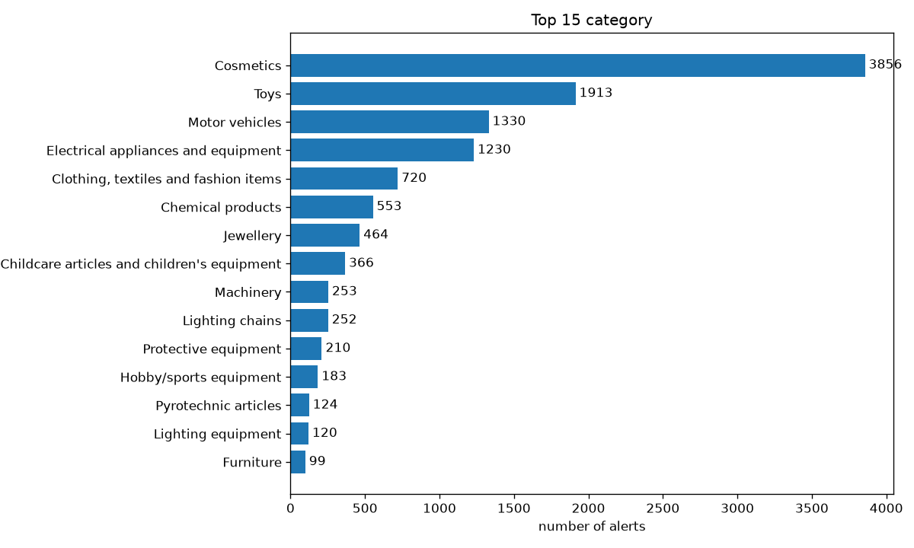

| Rank | Category | Alerts | Share | Cumulative |
|---|---|---|---|---|
| 1 | Cosmetics | 3,856 | 31.6% | 31.6% |
| 2 | Toys | 1,913 | 15.7% | 47.2% |
| 3 | Motor vehicles | 1,330 | 10.9% | 58.1% |
| 4 | Electrical appliances and equipment | 1,230 | 10.1% | 68.2% |
| 5 | Clothing, textiles and fashion items | 720 | 5.9% | 74.1% |
| 6 | Chemical products | 553 | 4.5% | 78.6% |
| 7 | Jewellery | 464 | 3.8% | 82.4% |
| 8 | Childcare articles and children's equipment | 366 | 3.0% | 85.4% |
| 9 | Machinery | 253 | 2.1% | 87.5% |
| 10 | Lighting chains | 252 | 2.1% | 89.6% |

**Findings (categories, all 12,211 alerts)**

- 73 different categories, but the data is very skewed: **Cosmetics is the
  most populated (3,856 alerts, 31.6%)**, followed by Toys (15.7%).
- The top 4 categories hold 68% of all alerts, the top 10 hold 90%.
- 59 categories have fewer than 100 alerts and 50 have fewer than 30. Scores
  per category are not reliable for those, so evaluate per category only for
  the big ones.
- A random split or a nearest-neighbour vote is dominated by Cosmetics. The
  split should keep the category mix visible (plan section 5).

### Brands, countries and risk types

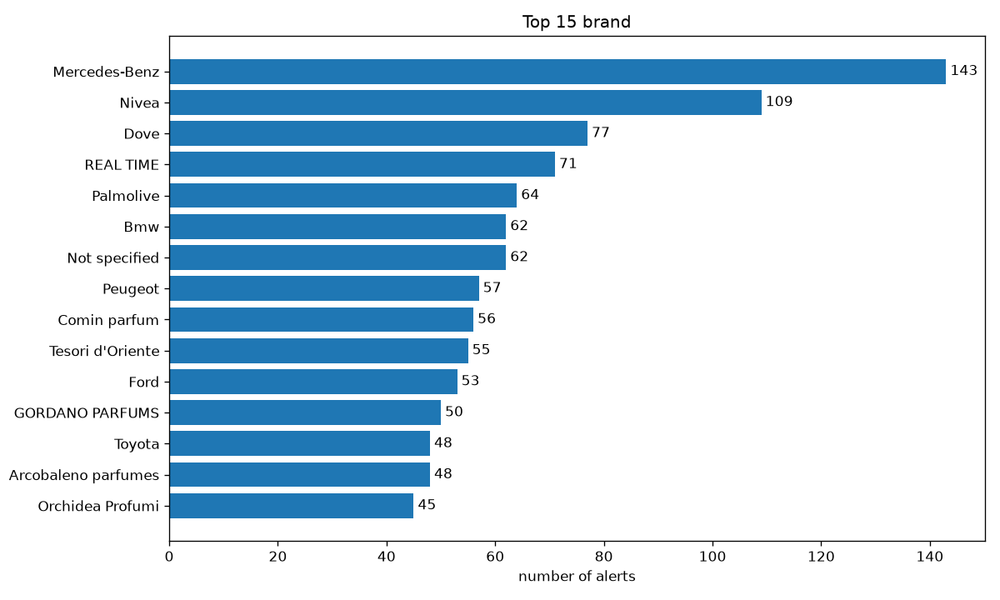

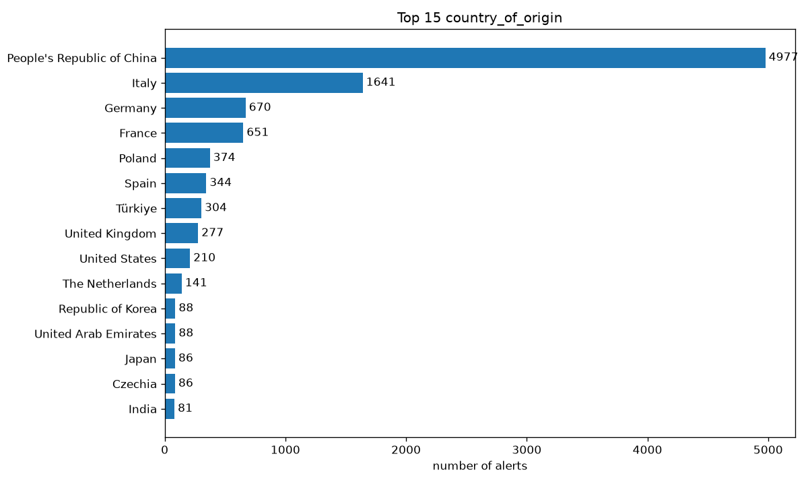

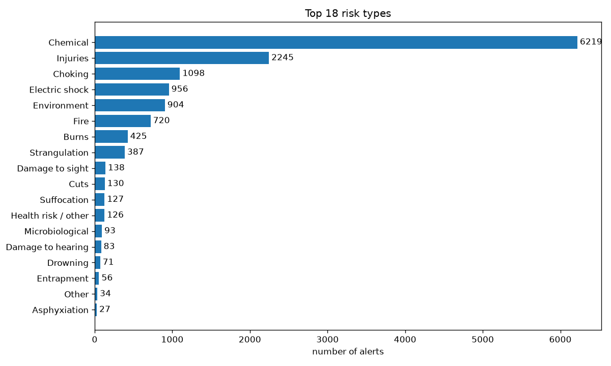

**Findings**

- TODO: write down the top brands, countries and risk types, and how skewed
  they are.

## 8. Does the length change across groups?

```{python}
by_category = length_by_group(cleaned_rows, "category")
```

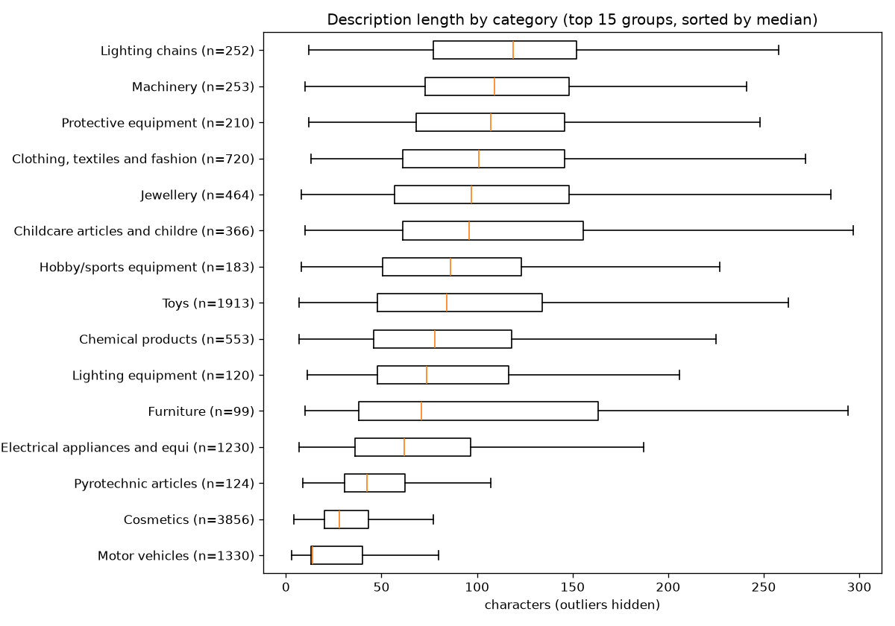

```{python}
by_product = length_by_group(cleaned_rows, "product")
```

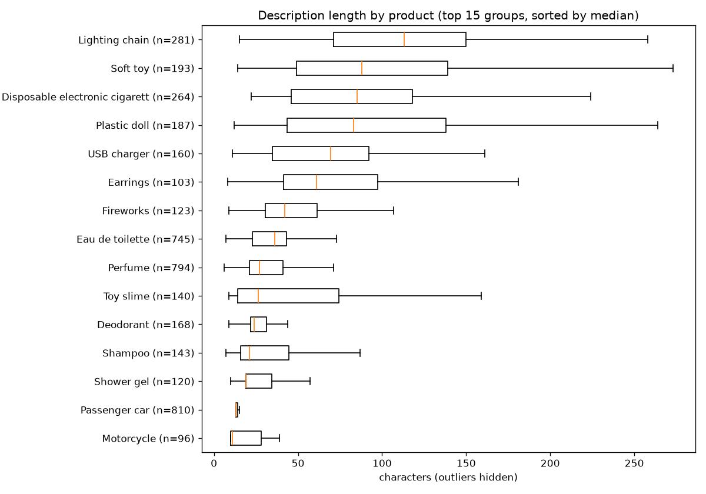

**Findings** (description length in characters; groups with 30+ alerts, top 15)

| Category | Alerts | Median | 95th pct |
|---|---|---|---|
| Motor vehicles | 1,330 | 14 | 102 |
| Cosmetics | 3,856 | 28 | 91 |
| Pyrotechnic articles | 124 | 42 | 121 |
| Electrical appliances and equipment | 1,230 | 62 | 177 |
| Toys | 1,913 | 84 | 236 |
| Clothing, textiles and fashion items | 720 | 101 | 226 |
| Machinery | 253 | 109 | 290 |
| Lighting chains | 252 | 119 | 225 |

- **Yes, the length changes a lot.** The median in the longest groconup
  (Lighting chains, 119) is about 8x the median in the shortest (Motor
  vehicles, 14). By product it is the same: Motorcycle 11, Passenger car 13,
  Perfume 27, Plastic doll 83, Lighting chain 113.
- The two biggest groups are among the shortest: Cosmetics (median 28) and
  Motor vehicles (14). Roughly 40% of all alerts have short texts, so the
  similarity search has little to match for them.
- "Motorcycle" alone (index 4) carries almost no signal, which supports the
  `product + description` text, but it still repeats the same words.
- When comparing models on dev, report results per category, not only overall.

## 9. Risk types

```{python}
plot_risk_types(alerts, top_n=18)
```


| Risk type | Alerts | Share of 12,211 |
|---|---|---|
| Chemical | 6,219 | 50.9% |
| Injuries | 2,245 | 18.4% |
| Choking | 1,098 | 9.0% |
| Electric shock | 956 | 7.8% |
| Environment | 904 | 7.4% |
| Fire | 720 | 5.9% |
| Burns | 425 | 3.5% |
| Strangulation | 387 | 3.2% |
| (9 more, from Damage to sight 138 down to Asphyxiation 27) | | |

**Findings**

- 18 different risk types, with a very uneven spread. **Chemical is on about
  half of all alerts (50.9%)**, Injuries on 18.4%. These two alone are on more
  alerts than the other 16 together.
- 10,826 alerts (88.7%) have one risk type, 1,164 have two, 204 have three and
  17 have four or more. Shares add up to more than 100% because an alert can
  count for several risk types.
- Rare types are very small: Other (34) and Asphyxiation (27). A classifier
  or a neighbours vote will almost never see them, so score per risk type
  and not only overall (accuracy alone would look good by guessing Chemical).
- Chemical is mostly Cosmetics (next section), so the "easy half" of the data
  is one category.

## 10. Risk type by category

```{python}
risk_by_category = risk_type_by_category(cleaned_rows)
```

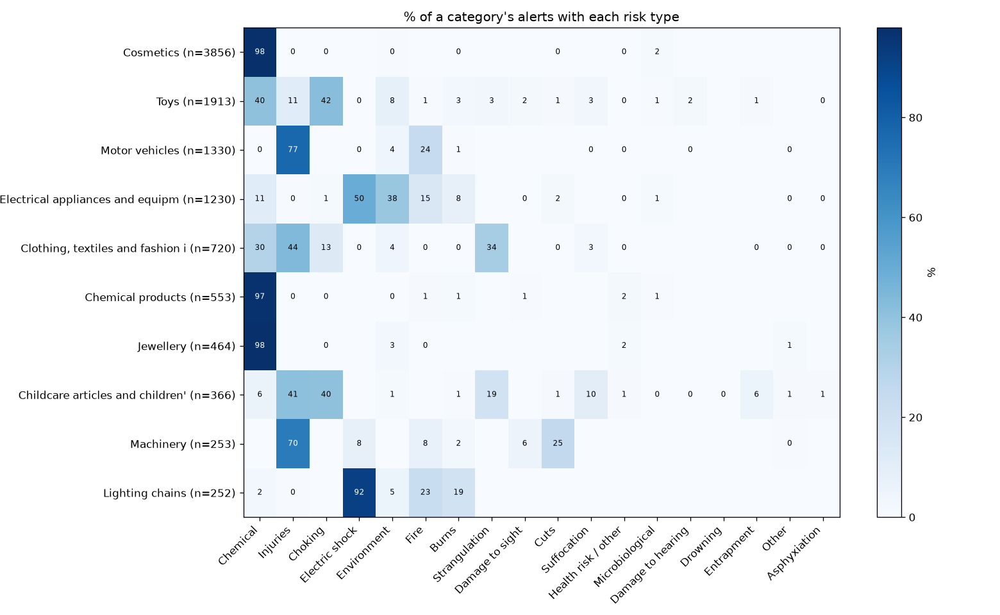

Each number is the % of that category's alerts with the risk type (top 10
categories).

| Category | Alerts | Top risk types |
|---|---|---|
| Cosmetics | 3,856 | Chemical 98% |
| Toys | 1,913 | Choking 42%, Chemical 40%, Injuries 11% |
| Motor vehicles | 1,330 | Injuries 77%, Fire 24% |
| Electrical appliances and equipment | 1,230 | Electric shock 50%, Environment 38%, Fire 15% |
| Clothing, textiles and fashion items | 720 | Injuries 44%, Strangulation 34%, Chemical 30% |
| Chemical products | 553 | Chemical 97% |
| Jewellery | 464 | Chemical 98% |
| Childcare articles and children's equipment | 366 | Injuries 41%, Choking 40%, Strangulation 19% |
| Machinery | 253 | Injuries 70%, Cuts 25% |
| Lighting chains | 252 | Electric shock 92%, Fire 23%, Burns 19% |

**Findings**

- **The category is a strong hint for the risk type in some groups:**
  Cosmetics, Chemical products and Jewellery are about 97 to 98% Chemical;
  Lighting chains are 92% Electric shock; Motor vehicles 77% Injuries.
- **Other categories are mixed.** Toys split between Choking (42%) and
  Chemical (40%); Clothing and Childcare spread over three risks. This is
  where the product text has to do the work.
- Jewellery being Chemical (not a physical danger) shows why "looks like" is
  not "is": a necklace is judged on metals such as cadmium or lead.
- A baseline that only predicts the most common risk of the category is a
  fair, cheap yardstick for the model to beat.

## 11. Length of risk_description

```{python}
risk_description_stats = text_length_distribution(cleaned_rows, "risk_description")
```

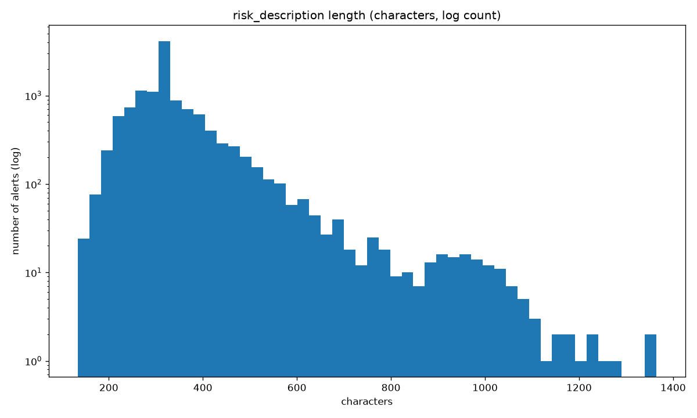

| Measure | Characters |
|---|---|
| min | 134 |
| median | 329 |
| mean | 344.8 |
| 90th percentile | 461 |
| 95th percentile | 538 |
| 99th percentile | 876 |
| max | 1,364 |

**Findings**

- Typical length is 329 characters (about 60 words), roughly **6.5x longer
  than the product description** (median 50). No risk_description is empty
  (shortest is 134).
- **No heavy long tail:** the 99th percentile is 2.7x the median (the
  `long_tail` flag needs more than 5x), and only 53 rows (0.4%) are longer
  than 3x the median. The distribution leans a little to the right and stops
  at 1,364 characters (about 300 tokens).
- Even the longest text fits both embedding models (384 and 512 tokens), so
  nothing is cut off.
- It is written by the inspector and usually names the danger, for example
  "The user could receive an electric shock". It is an answer field: use it
  for evaluation and analysis, never in the text that is embedded.

## 12. Types of law names

(`raw_names` was read as the raw `law_names` values. Tell me if another field
was meant.)

```{python}
law_stats = law_name_types(cleaned_rows)
```

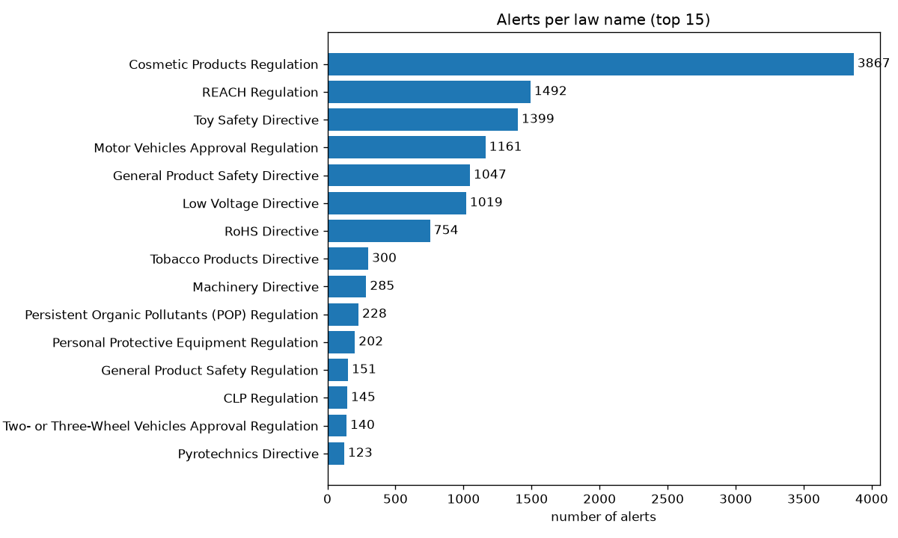

| Kind (read from the name) | Different laws | Law mentions in alerts |
|---|---|---|
| Directive | 17 | 5,048 |
| Regulation | 15 | 7,489 |
| Decision | 1 | 108 |
| **Total** | **33** | 12,645 |

| Laws per alert | Alerts |
|---|---|
| 0 | 33 |
| 1 | 11,726 (96.0%) |
| 2 | 437 |
| 3 | 15 |

**Findings**

- 33 different law names: 17 Directives, 15 Regulations and 1 Commission
  Decision (flail-type cutting attachments). Names are clean, with no stray
  spaces and no spelling variants.
- Most common: Cosmetic Products Regulation (3,867), REACH Regulation (1,492),
  Toy Safety Directive (1,399), Motor Vehicles Approval Regulation (1,161),
  General Product Safety Directive (1,047) and Low Voltage Directive (1,019).
- 96% of alerts cite exactly one law; 33 alerts (0.3%) cite none. Those 33
  are the missing `law_names` from Section 5.
- Some law names are the same rule at different times (General Product Safety
  Directive 1,047 and General Product Safety Regulation 151). Group them if
  they are used as a label.

## 13. Law name vs risk type vs category

```{python}
law_summary = law_risk_category(cleaned_rows)
```

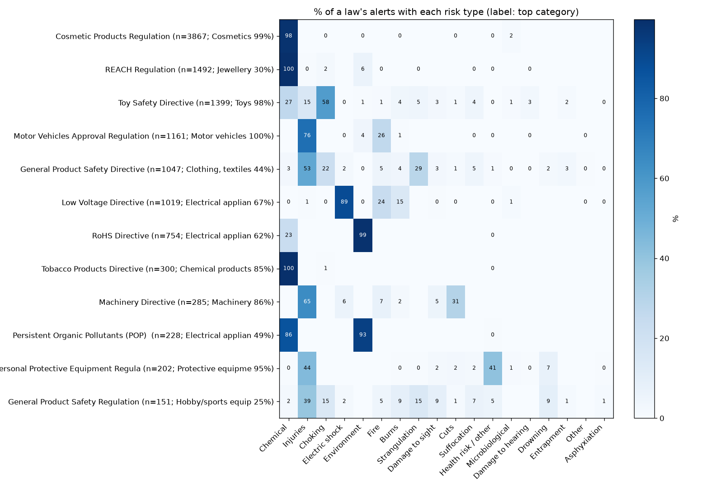

| Law | Alerts | Top category | Top risk type |
|---|---|---|---|
| Cosmetic Products Regulation | 3,867 | Cosmetics 99% | Chemical 98% |
| REACH Regulation | 1,492 | Jewellery 30% (spread) | Chemical 100% |
| Toy Safety Directive | 1,399 | Toys 98% | Choking 58% |
| Motor Vehicles Approval Regulation | 1,161 | Motor vehicles 100% | Injuries 76% |
| General Product Safety Directive | 1,047 | Clothing 44% (spread) | Injuries 53% |
| Low Voltage Directive | 1,019 | Electrical appliances 67% | Electric shock 89% |
| RoHS Directive | 754 | Electrical appliances 62% | Environment 99% |
| Tobacco Products Directive | 300 | Chemical products 85% | Chemical 100% |
| Machinery Directive | 285 | Machinery 86% | Injuries 65% |
| POP Regulation | 228 | Electrical appliances 49% | Environment 93% |

**Findings**

- **Specific laws point to one risk type:** RoHS and POP mean Environment
  (99% and 93%), Low Voltage means Electric shock (89%), REACH and Tobacco
  mean Chemical (100%). Laws such as Cosmetic Products, Toy Safety and Motor
  Vehicles also stay inside one category (98 to 100%).
- **General laws say little:** the General Product Safety Directive and
  Regulation spread over many categories and risk types (Injuries 53% and
  39%).
- The same category can have different laws and risks: Electrical appliances
  appear under Low Voltage (Electric shock), RoHS and POP (Environment).
- Law and risk type are answer fields, so the law is a useful **second thing to
  predict** and a check on the answer (a Chemical guess for a Low Voltage case
  is suspicious). Do not give it to the model as input.

## 14. Time trend

`report_date` is dropped by `clean_row`, so this uses the raw `alerts`.

```{python}
trend = time_trend(alerts)
```

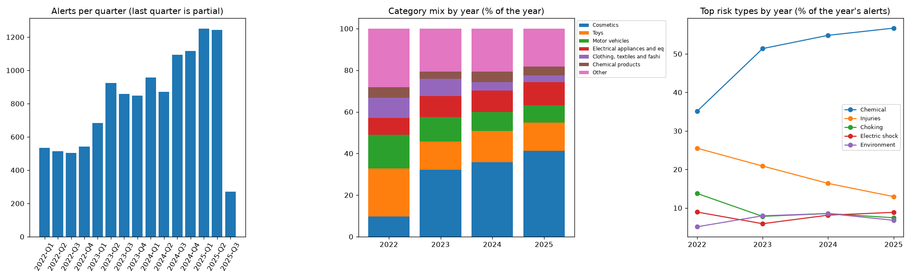

| Year | Alerts | Cosmetics | Toys | Motor vehicles | Chemical risk | Injuries risk |
|---|---|---|---|---|---|---|
| 2022 | 2,093 | 9.7% | 23.1% | 16.3% | 35.1% | 25.5% |
| 2023 | 3,315 | 32.2% | 13.5% | 11.9% | 51.4% | 20.9% |
| 2024 | 4,037 | 35.8% | 15.1% | 9.1% | 54.8% | 16.4% |
| 2025 (to 18 July) | 2,766 | 41.3% | 13.5% | 8.3% | 56.7% | 12.9% |

**Findings**

- Dates run from 2022-01-07 to 2025-07-18, none missing, and the file is sorted
  by date.
- The volume grew: about 520 alerts per quarter in 2022, about 1,250 in the
  first half of 2025. The last quarter (2025-Q3, 271 alerts) is only 18 days.
- **The mix changed a lot.** Cosmetics went from 9.7% (2022) to 41.3% (2025),
  while Toys, Motor vehicles and Clothing shrank.
- The risk types follow: Chemical rose from 35% to 57%, Injuries fell from 26%
  to 13%, Choking from 14% to 7%.
- **Consequence for the split:** a date split (old for the library, newest for
  the test) puts a test set that is about 41% Cosmetics against a library
  built from 2022 to 2024 that is about 29% Cosmetics. Scores on the test set will lean on
  how well Cosmetics goes (98% Chemical), so report per category, not only
  overall. A random split would hide this shift and look better than real use.

## 15. Do similar descriptions share a risk?

A plain word-based check (TF-IDF on product + description, no embeddings). For
every alert it finds the 5 most similar other alerts and checks the risk type.
A "hit" means the guess is one of the alert's true risk types. Identical texts
are left out in the second setting, because twins make the result look too good.

```{python}
similar = similar_descriptions_share_risk(cleaned_rows)
```

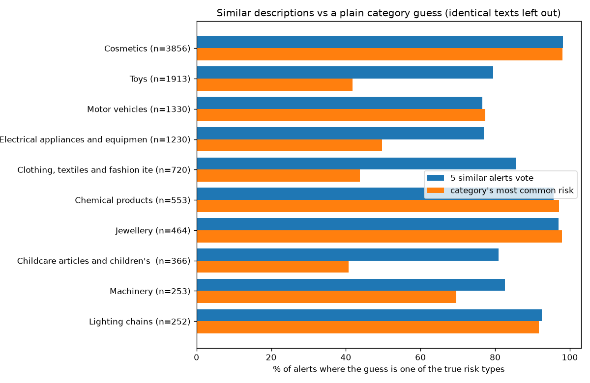

| Method | Hit rate |
|---|---|
| Always guess Chemical | 50.9% |
| Most common risk of the alert's category | 72.7% |
| Closest alert shares a risk type (identical texts left out) | 84.9% |
| Closest alert has exactly the same set of risk types | 75.1% |
| Vote of the 5 closest alerts (identical texts left out) | **87.0%** |

| Category | Alerts | 5-alert vote | Category's most common risk |
|---|---|---|---|
| Cosmetics | 3,856 | 98.1% | 98.0% |
| Toys | 1,913 | 79.5% | 41.8% |
| Motor vehicles | 1,330 | 76.6% | 77.3% |
| Electrical appliances and equipment | 1,230 | 77.0% | 49.7% |
| Clothing, textiles and fashion items | 720 | 85.6% | 43.8% |
| Chemical products | 553 | 95.7% | 97.1% |
| Jewellery | 464 | 97.0% | 97.8% |
| Childcare articles and children's equipment | 366 | 80.9% | 40.7% |
| Machinery | 253 | 82.6% | 69.6% |
| Lighting chains | 252 | 92.5% | 91.7% |

**Findings**

- **Yes, mostly.** The closest alert shares a risk type in 85% of cases, and
  a vote of 5 gets it right 87% of the time, well above "always Chemical"
  (50.9%) and above the category guess (72.7%).
- **Where it helps:** Toys, Electrical appliances, Clothing and Childcare. There
  the category alone is right only 41 to 50% of the time and similar texts
  lift it to 77 to 86%.
- **Where it does not:** Cosmetics, Chemical products, Jewellery and Motor
  vehicles. The category already gives the answer (97 to 98%), so similar
  texts add nothing. For Motor vehicles it is slightly worse (76.6% vs 77.3%).
- Leaving out identical texts changes little (86.4% to 84.9% for the closest
  alert), so twins are not what drives the score.
- This is the **ceiling-style baseline** to beat with embeddings: about 87% hit
  rate with plain words. It is also an easy measure (any one of several true
  risks counts) and a random neighbour search over all years. A date split
  and a stricter "exact match" score (75%) will be lower.

## 16. Leakage check

Does the product text already name the danger? Looks for danger words (such as
"choking", "shock", "flammable", "burn") in product + description.

```{python}
leakage = leakage_check(cleaned_rows)
```

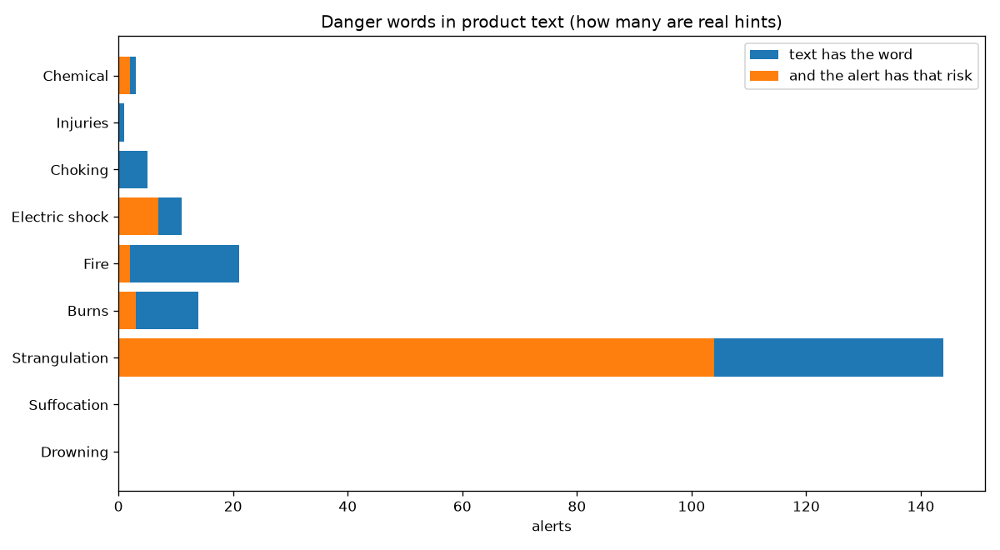

| Risk type | Alerts with its words | Really have the risk | Precision |
|---|---|---|---|
| Chemical | 3 | 2 | 67% |
| Injuries | 1 | 0 | 0% |
| Choking | 5 | 0 | 0% |
| Electric shock | 11 | 7 | 64% |
| Fire | 21 | 2 | 10% |
| Burns | 14 | 3 | 21% |
| Strangulation | 144 | 104 | 72% |
| Suffocation, Drowning | 0 | 0 | |

**Findings**

- **Direct leakage is rare:** only 118 of 12,211 alerts (1.0%) name one of
  their own risk types in the product text.
- When a danger word is in the text it is often not the real risk (Fire 10%,
  Choking 0%): the word shows up in the product text without being the
  alert's risk (reasons not checked; look at the matching rows to see why).
- The one frequent cue is Strangulation (144 alerts, 72% right), mostly
  "drawstring" and "cord". That is a **product feature that really is the
  danger**, not leakage, and a good signal for the model.
- So the plan's "hint-removed run" would change very little for this data. The
  larger risk is not leakage by words but **leakage by twins** (Section 4).
- This check uses a short word list. It misses hints in other words, but a
  larger effect would show in Section 15, where the plain-word search was
  already strong.

## 17. Multi-risk alerts

```{python}
multi = multi_risk_alerts(cleaned_rows)
```

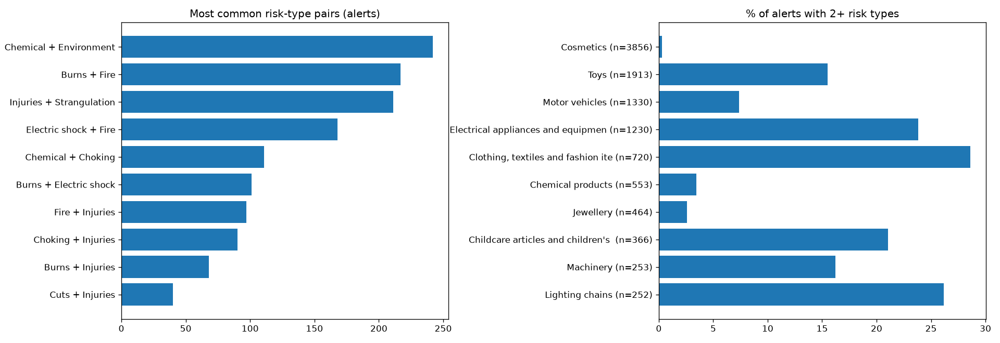

| Risk types per alert | Alerts |
|---|---|
| 1 | 10,826 (88.7%) |
| 2 | 1,164 |
| 3 | 204 |
| 4 or more | 17 |

| Pair | Alerts |
|---|---|
| Chemical + Environment | 242 |
| Burns + Fire | 217 |
| Injuries + Strangulation | 211 |
| Electric shock + Fire | 168 |
| Chemical + Choking | 111 |

**Findings**

- 1,385 alerts (11.3%) have two or more risk types, the most with 8.
- The pairs make physical sense: Burns + Fire, Electric shock + Fire (a fault
  that heats up), Injuries + Strangulation (cords on clothing and toys).
  Chemical + Environment goes together for the restricted-substance laws.
- **Multi-risk depends on the category:** Clothing (28.6%), Lighting chains
  (26.2%), Electrical appliances (23.8%) and Childcare (21.0%) are high, while
  Cosmetics (0.3%) and Jewellery (2.6%) are almost always one risk.
- **Scoring rule to decide:** with 11% multi-risk, "exact set" and "any risk
  matches" give different scores (75% vs 85% in Section 15). Use "the top guess
  is one of the true risks" as the main score, and report exact set as a
  stricter second number.

## 18. Product variety

```{python}
variety = product_variety(cleaned_rows)
```

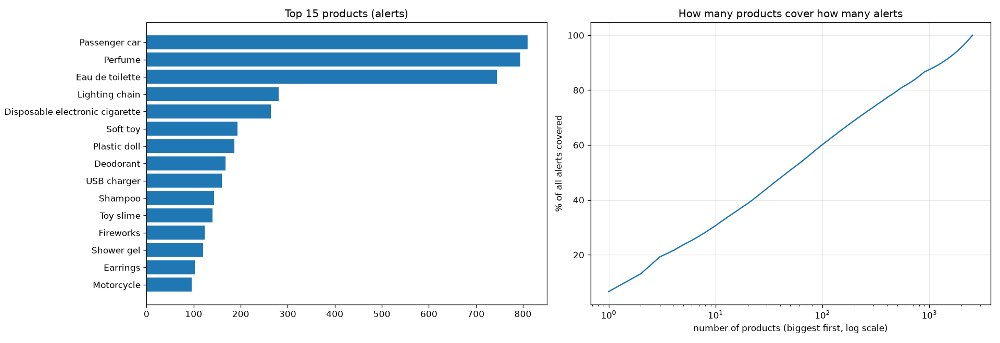

| Measure | Value |
|---|---|
| Different products (as written) | **2,526** |
| After lower-casing and trimming | 2,490 |
| Products that appear only once | 1,628 (64% of the products) |
| Products with 5 alerts or fewer | 2,264 (90%) |
| Products with 30+ alerts | 53 |
| Products with 100+ alerts | 14 |
| Products found in more than one category | 161 |

| Biggest products | Share of all 12,211 alerts |
|---|---|
| Top 10 | 30.7% |
| Top 50 | 50.8% |
| Top 100 | 60.2% |
| Top 500 | 79.8% |

Top 3: Passenger car (810), Perfume (794), Eau de toilette (745).

**Findings**

- **2,526 different products, a very long tail.** Two out of three products
  occur once. Just 53 products (those with 30+ alerts) cover about half of the
  alerts (6,302, 51.6%); the other 2,473 share the rest.
- Writing differs: 36 names collapse when case is ignored (for example
  "Soft toy" and "SOFT TOY", "Passenger Car" and "Passenger car"). Normalise
  (lower-case, trim) before counting or grouping by product.
- 161 products appear under more than one category, so `product` and
  `category` are not interchangeable.
- **Consequence:** a model cannot learn most products one by one. For about
  1,600 products there is a single alert, so a new product has to be
  understood from its words and similar products, not from a list. This is the
  reason for a similarity search over a plain lookup table.

## 19. Product vs risk type

Only products with 30 or more alerts are used here (53 products, 6,302 alerts).
A product with one or two alerts proves nothing.

```{python}
product_risk = product_vs_risk(cleaned_rows)
```

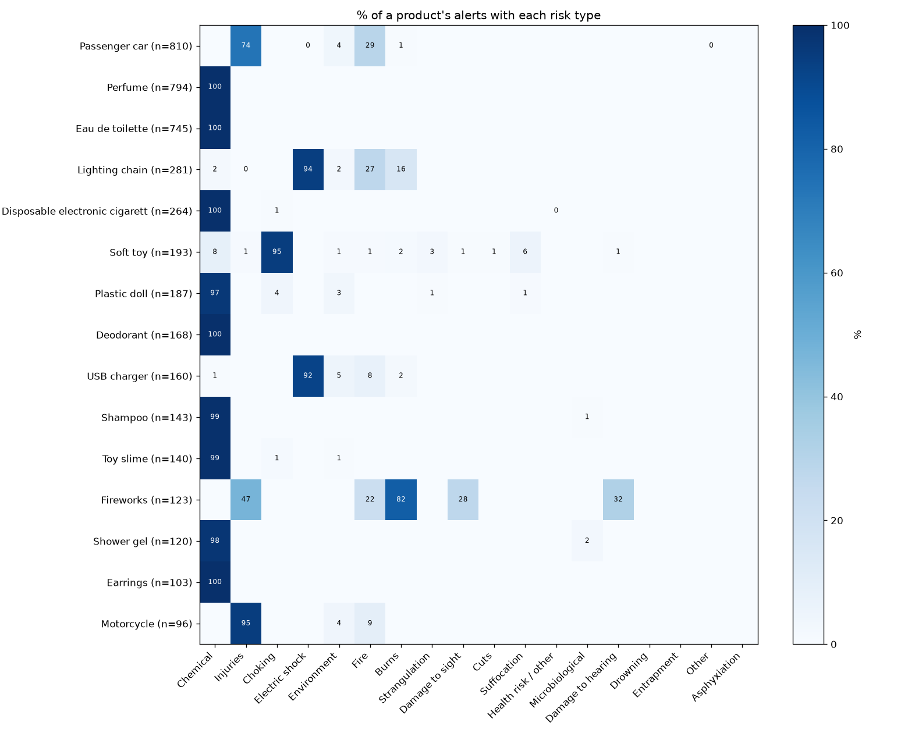

| Product | Alerts | Top risk types |
|---|---|---|
| Passenger car | 810 | Injuries 74%, Fire 29% |
| Perfume | 794 | Chemical 100% |
| Eau de toilette | 745 | Chemical 100% |
| Lighting chain | 281 | Electric shock 94%, Fire 27% |
| Disposable electronic cigarette | 264 | Chemical 100% |
| Soft toy | 193 | Choking 95% |
| Plastic doll | 187 | Chemical 97% |
| USB charger | 160 | Electric shock 92% |
| Fireworks | 123 | Burns 82%, Injuries 47%, Damage to hearing 32% |
| Earrings | 103 | Chemical 100% |
| Motorcycle | 96 | Injuries 95% |

| How pure the product's most common risk is | Products |
|---|---|
| 90% or more | 45 |
| 60 to 90% | 7 |
| Under 60% | 1 (Plastic toy: Choking 55%) |

| Guess for each alert, leaving that alert out | Hit rate |
|---|---|
| Most common risk of the **same product** | **93.3%** |
| Most common risk of the **same category** (same alerts) | 84.5% |

**Findings**

- **For the common products, the product tells you the risk.** In 45 of 53
  products the top risk is on 90% or more of the alerts: Perfume, Eau de
  toilette, Deodorant, Earrings and E-cigarettes are all Chemical;
  Soft toy is Choking (95%); USB charger and Lighting chain are Electric shock.
- The product beats the category: 93.3% against 84.5% on the same alerts.
  So the product text adds information beyond the category.
- **The mixed products are the hard ones:** Plastic toy (Choking 55%),
  Soother holder (67%), Passenger car (Injuries 74%, with Fire in 29%),
  Children's dress (74%), Lorry (79%), Fireworks (82%, a spread of Burns,
  Injuries and Damage to hearing). These need the description.
- Chemical risk has nothing visible in the product: a perfume or earring is
  judged on its ingredients and metals (general knowledge, not checked in the
  data). A look-alike search finds the same product type and still works, but
  the description cannot say why.
- **The duck problem (plan section 8) shows up in small numbers:** the 5 alerts
  whose product is Plastic duck, Toy duck or Rubber duck have Choking (2),
  Chemical (2) and Environment (1). Similar products do not always share a risk.
- This is a favourable test: it only covers the 53 big products (52% of the
  alerts). The 2,473 rare products have too few alerts to measure this way.

## 20. Decisions that follow from the findings

| Finding | Decision | Where it is used |
|---|---|---|
| (fill in) | (fill in) | (box / plan section) |
